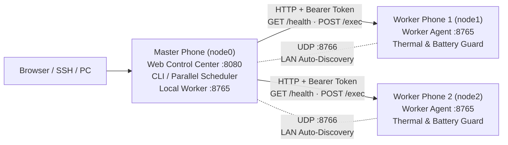

# PhoneCluster

**Turn spare Android 7+ phones into one unified, thermally safe Linux computer — with an accessible Web Control Center, Wi-Fi auto-discovery, and zero pip dependencies.**

[](https://github.com/andreasNosalSK/phonecluster/actions/workflows/ci.yml)


---

## Why PhoneCluster?

Old smartphones pack 8-core ARM64 CPUs, gigabytes of LPDDR4X RAM, UFS/eMMC storage, Wi-Fi 5, and built-in UPS batteries — while sipping **~5.5 W total** across a 3-phone Wi-Fi cluster (~€9–€13/year in electricity).

PhoneCluster gives you **one entry point** (Web UI + interactive terminal menu + CLI) hosted on your strongest **Master phone**, automatically distributing parallel jobs across all phones while protecting them from overheating and battery swelling.

### Highlights
- **Shared Multi-Device `btop` Web Control Center** (`pc dashboard` on port `8080`):
  - Live **SVG area sparklines** for Cluster CPU, Cluster Memory, Peak Thermal, Running Tasks, and Network RX/TX across all phones, plus **per-core CPU heat bars** and **shared Top Processes** per device.
  - **Interactive Multi-Node Web Terminal**: run Linux commands on any phone (or broadcast to ALL phones) directly from your browser with persistent `cd` working directories, `↑/↓` history, `Ctrl+L` clear, and one-click job cancel.
  - **Accessible by design**: Midnight Dark / Daylight Light / **High-Contrast** themes + **Normal / Large / XL** text scaling + full keyboard navigation + color-blind safe badges. Works 100% offline on your LAN.
- **Shared Multi-Device `btop` Terminal Control** (`pc top`):
  - Gorgeous ANSI 256-color full-screen terminal UI with Unicode rounded panels, sparklines (`▁▂▃▄▅▆▇█`), per-core heat bars, live running tasks & shared processes, and interactive keyboard controls (`↑/↓` select phone, `r` run, `a` broadcast, `s` instant SSH shell, `c` cancel job, `d` toggle tasks/processes).
- **Security-First Zero-Config Pairing (`pc pair` + `pc join`)**:
  - Cluster is **completely silent on UDP by default** — strangers on Wi-Fi cannot scan or sneak into your cluster.
  - Opening a temporary **2-minute Pairing Window** lets new phones auto-find your Master on Wi-Fi and join with a **6-digit PIN**, protected by **2048-bit Ephemeral Diffie-Hellman + PBKDF2-HMAC-SHA256 + Mutual Proof + Encrypt-then-MAC** (zero pip dependencies!).
  - Every paired phone gets its **own unique per-node 256-bit token** (least-privilege isolation), 5-attempt lockout, brute-force `429` rate limiting, and optional `pc dashboard --require-auth` lockdown for shared Wi-Fi.
  - Also includes a PC USB Fleet Provisioner ([`scripts/setup_all_via_adb.sh`](scripts/setup_all_via_adb.sh)), One-Line Installer ([`install.sh`](install.sh)), Guided Setup Wizard (`pc wizard`), and Cluster Doctor (`pc doctor`).
- **Optional Master Network Guard (Air-Gap Old Phones from WAN)**:
  - **OFF by default** — turn ON in Web UI (**Tab 5**) or via `pc gateway --enable` when you block direct internet (WAN) on your router for older unpatched worker phones.
  - Routes approved worker traffic through Master's (or a Raspberry Pi Zero 2 W Master's) authenticated HTTP/HTTPS allowlist proxy with per-node derived credentials, SSRF private-IP blocking, live traffic audit logs, and one-click router WAN-isolation verification.
- **Smart Parallel Scheduling & Hardware Safety**:
  - Dynamically ships & runs local Python/Bash scripts across all cool, ready phones (`pc map --script ...`) with automatic retry/failover if a phone throttles or disconnects.
  - **Thermal Gate with hysteresis** pauses jobs at `40 °C` and resumes at `37 °C`.
  - **24/7 Battery Guard** fires alerts or a smart-plug / Home Assistant webhook to keep unrooted Li-Po batteries in the safer `45–60%` range.
- **Heterogeneous Multi-Tier Orchestration (One Seamless System!)**:
  - Freely mix **Tier 1 (Unrooted Termux — compute/LLMs)** + **Tier 2 (Native Debian 13 ARM64 chroot — Mosquitto MQTT, AdGuard Home, glibc services)** + **Tier 3 (Custom Kernel + Droidspaces — Docker containers, Home Assistant)** inside the **same cluster**!
  - **Automatic Smart Routing (`--target auto` default)**: Docker commands automatically go to Tier 3, Debian/MQTT/AdGuard service commands go to Tier 2, and parallel Python/AI/compiler tasks spread across Tier 1 (spilling over cleanly to cool Tier 2/3 phones if Tier 1 gets busy or warm).
  - **Automatic Cross-Tier Service Mesh**: Every job on every tier automatically receives live `$PHONECLUSTER_MQTT_HOST`, `$PHONECLUSTER_HOMEASSISTANT_URL`, `$PHONECLUSTER_ADGUARD_URL`, `$PHONECLUSTER_LLAMA_API_URL`, `$PHONECLUSTER_POOL_*_HOSTS`, etc. — plus one-click `.cluster` DNS rewrites (`mqtt.cluster`, `ha.cluster`, `adguard.cluster`) and **Cross-Tier Pipelines** (`pc pipeline`).
- **OS-Agnostic Upgrade Path**:
  - Starts in 15 minutes on **unrooted Termux** (no bootloader unlock required), and upgrades phone-by-phone to Tier 2 or Tier 3 whenever you're ready (`examples/mixed_cluster.example.json`).

---

## Architecture



---

## Quickstart (3 Easy Steps, €0 Upfront)

### Step 1 — Prepare your phones (from your PC over USB)
Install **Termux**, **Termux:Boot**, and **Termux:API** from the **exact same source** (all from [F-Droid](https://f-droid.org/) or all from GitHub Releases — **never** Google Play). Open Termux:Boot once manually on each phone.

Enable **USB Debugging**, connect your phones to your PC, and run:
```bash
./scripts/setup_all_via_adb.sh
```
This audits every connected phone, ranks your best Master (`node0`), disables Android 12/13's Phantom Process Killer, whitelists Termux from Doze, and auto-generates `config/cluster.json`. Reboot each phone when done.

### Step 2 — One-line install inside Termux on each phone
```bash
curl -fsSL https://raw.githubusercontent.com/andreasNosalSK/phonecluster/main/install.sh | bash
```
The installer clones/updates PhoneCluster, installs `openssh`, `termux-api`, `python`, sets up `~/.termux/boot/` auto-start, and creates global `pc` / `phonecluster` commands. Choose **Master** on `node0` and **Worker** on the others.

### Step 3 — Add more phones in 15 seconds (Secure Auto-Search Pairing!)
1. On your **Master phone**, open a temporary 2-minute Pairing Window:
   - Either click **Tab 5 → Open Pairing Window (2 min)** in the Web Control Center (`pc dashboard`), OR run `pc pair` in terminal → note the **6-digit PIN** (e.g. `482-917`).
2. On your **new Worker phone**, run `pc join` (or `curl -fsSL https://raw.githubusercontent.com/andreasNosalSK/phonecluster/main/install.sh | bash` → pick Worker):
   - It automatically finds your Master on Wi-Fi, verifies the fingerprint & 6-digit PIN over **2048-bit Diffie-Hellman**, saves its own unique least-privilege token, configures Termux:Boot, and starts the worker!
   - The pairing window immediately auto-closes so strangers on Wi-Fi can never join.

```bash
pc                                    # Open interactive numbered menu
pc top                                # Pretty multi-device shared btop + Terminal Control!
pc dashboard                          # Start Web Control Center (--require-auth for shared Wi-Fi)
pc pair                               # (Master) Open 2-min encrypted Pairing Window (6-digit PIN)
pc join                               # (New phone) Auto-find Master on Wi-Fi & securely join
pc status --watch                     # Quick live-refreshing status table
pc jobs                               # See active & recent jobs across all phones
pc cancel node1 <job_id>              # Cancel a runaway job on any phone
pc ssh node1                          # Instant SSH into a phone by node name
pc copy model.gguf ~/models/          # Copy datasets/models to all worker phones via SCP
pc token                              # Show unlock token for Web UI (`--rotate` to renew)
pc sync                               # Sync code & scoped least-privilege configs to workers
pc update --sync                      # Pull latest updates from GitHub & push to workers
pc doctor                             # Check SSH, security isolation, temps, 24/7 battery safety
pc wizard                             # Guided interactive setup wizard

# Heterogeneous Multi-Tier Pools, Auto-Routing & Cross-Tier Pipelines
pc pools                              # View Tier 1 (compute) / Tier 2 (services) / Tier 3 (docker) pools
pc services                           # Discover live cross-tier services (MQTT, AdGuard, HA, AI, Docker)
eval "$(pc services --env)"           # Export live $PHONECLUSTER_* service URLs into your shell
pc services --hosts                   # Generate .cluster DNS rewrites for AdGuard Home / /etc/hosts
pc pipeline examples/cross_tier_pipeline.json  # Chain Tier 1 -> Tier 2 -> Tier 3 in one workflow

# Run commands & parallel scripts (auto-routes to ideal Tier/Pool by default!)
pc run "uname -a && nproc"            # Auto-routes compute -> Tier 1 (spills over if warm)
pc run "docker ps"                    # Auto-routes strictly -> Tier 3 (Docker pool)
pc run --target tier:2 "apt-cache policy mosquitto"  # Explicitly target Tier 2 Debian pool
pc run --target all "uptime"          # Broadcast to all ready phones across all tiers
pc map --script examples/sample_job.py --args-file examples/sample_args.txt

# Workload integrations
eval "$(pc distcc-env)"               # Compiler PC: export DISTCC_HOSTS from ready phones
pc llama-rpc                          # Local AI: print --rpc ip1:50052,ip2:50052
pc mpi-hostfile -o hosts.mpi          # OpenMPI: generate hostfile from ready phones
```

---

## Choosing Your OS Tier (Termux vs. Debian 13 vs. Docker)

| Tier | Root Needed? | Best For | Key Caveats |
| :--- | :--- | :--- | :--- |
| **Tier 1: Unrooted Termux** *(Default)* | No | Parallel scripts/jobs, `distcc`, `OpenMPI`, `llama.cpp` RPC & 1.5B–3B local LLMs, Web Dashboard | No native Docker, no port 53, no kernel `ACC` (use PhoneCluster's smart-plug webhook instead). |
| **Tier 2: Native Debian 13 ARM64 chroot** | Yes (Magisk + stock kernel) | **Full glibc Debian 13 (`apt`)**, Home Assistant Core venv, Mosquitto/Zigbee2MQTT, Nomad, Slurm, AdGuard Home (port 53), Tailscale/WireGuard, `vr-25/acc` battery limits | Stock Android 4.14 kernels omit namespaces/cgroups → no native Docker. |
| **Tier 3: Custom Kernel + Droidspaces** | Yes + custom kernel | **Native Docker Engine**, Home Assistant Container, K3s | Requires cross-compiling kernel with container `CONFIG_*` flags + sparse `ext4` rootfs images. |

---

## Documentation

- **[Security Architecture & Pairing Protocol](docs/SECURITY.md)** — Threat model, 2048-bit DH + PIN pairing, per-node token isolation, stealth LAN posture, and shared Wi-Fi lockdown.
- **[Complete Step-by-Step Setup Guide](docs/SETUP_GUIDE.md)** — Android settings, ADB fleet setup, secure pairing, and troubleshooting.
- **[Debian 13 & Docker Upgrade Guide](docs/DEBIAN13_AND_DOCKER.md)** — Upgrading to Tier 2 rooted Debian 13 ARM64 chroot, ACC battery protection, Home Assistant, and Tier 3 Docker/Droidspaces.
- **[Workloads & Automation Cookbook](docs/WORKLOADS.md)** — Recipes for Parallel Python/Bash, `distcc` Compiler PC, Local AI (`llama.cpp`), OpenMPI, and Home Assistant smart-plug battery protection.
- **[REST & Discovery API Reference](docs/API.md)** — Worker endpoints, Dashboard API, and UDP LAN discovery schema.

---

## 24/7 Battery Safety Warning

Never leave aging smartphone lithium-polymer batteries plugged in at **100% charge continuously 24/7** — continuous float charging accelerates gas swelling ("spicy pillows") and fire risk.
- **Unrooted (Tier 1):** Set `safety.battery_webhook_url` in `config/cluster.json` to trigger a Home Assistant automation or Wi-Fi smart plug that cycles power between **45% and 60%**.
- **Rooted (Tier 2/3):** Install the [`vr-25/acc`](https://github.com/vr-25/acc) Magisk module and run `acc -s pc=60 rc=55 mcv=3900 mcc=500`.
- **Cooling:** Stand phones **vertically with airflow gaps** — never stack them flat.

---

## Development & Tests

```bash
python3 -m unittest discover -s tests -v
bash -n install.sh scripts/*.sh
```

## License

[MIT](LICENSE)
