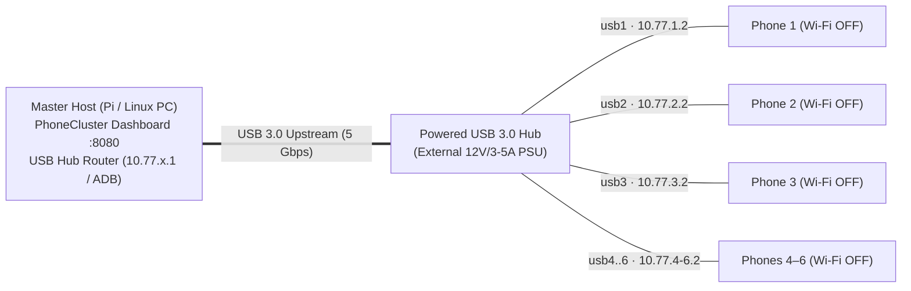

# USB 3.0 Hub Routing (Zero-Wi-Fi Multi-Phone Cluster)

Connect **2 to 6+ phones** into a single **powered USB 3.0 hub** so they communicate with your Master and directly with each other over wired USB — **with Wi-Fi completely turned OFF**.

---

## Hardware Reality Check (Read First!)

1. **You MUST connect the hub's upstream port to a USB Host:**
   - USB is a strict **Host → Device** tree, not a peer-to-peer Ethernet switch. Plugging 4–6 phones into a standalone USB hub with nothing on the upstream port will **not** connect them.
   - Connect the hub's upstream USB 3.0 cable to your **Master Host**:
     - **Recommended:** Raspberry Pi 4 / 5, Raspberry Pi Zero 2 W (via OTG), or any Linux mini-PC / laptop.
     - **Possible for 2–3 phones:** A Master phone in USB-C OTG Host mode using a USB-C PD pass-through hub (for 4–6 phones, a dedicated Pi/PC host is far more stable and avoids mobile OTG endpoint limits).
2. **Use a POWERED USB 3.0 Hub (external PSU, 12V/3A–5A):**
   - 4–6 phones draw ~15–30 W combined; an unpowered hub will brown out and drop USB connections.
   - Bonus: USB 3.0's 5 Gbps upstream link avoids congestion across 4–6 USB 2.0 (480 Mbps) phones, delivers **< 1 ms latency** (vs 5–20 ms Wi-Fi jitter), eliminates Wi-Fi interference, and trickles gentle charging current (500–900 mA/port) that runs cooler for 24/7 batteries!



---

## Choosing Between the Two USB Hub Modes

| Feature | Mode 1: **ADB USB Hub Mesh** (`--mode adb`) | Mode 2: **Layer-3 `/30` USB Subnet Router** (`--mode rndis`) |
| :--- | :--- | :--- |
| **Root required?** | **No** (works on unrooted Android & Ubuntu Touch with ADB) | Master Host `sudo` + Phone `sudo` (built-in on Ubuntu Touch!) |
| **Best for** | 4–6 unrooted Android Termux phones | **Ubuntu Touch + Snap Docker / Swarm**, OpenMPI, full IP/UDP |
| **Subnet collisions?** | **Impossible** (multiplexed by unique USB serial) | **Solved automatically** (`10.77.<k>.0/30` per phone by MAC) |
| **Phone-to-phone traffic** | Automatic `adb forward` + `adb reverse` peer port mesh | Full IPv4 routing across `10.77.0.0/16` via Master Host |
| **WAN Isolation** | 100% air-gapped (optional `adb reverse` to Network Guard `:8888`) | 100% air-gapped by default (optional `--nat-wan` or Network Guard) |

---

## Mode 1: Zero-Root ADB USB Hub Mesh (4–6 Phones)

Ideal for unrooted Android phones (or Ubuntu Touch with USB debugging enabled):

```bash
# 1. Inspect attached USB phones
pc usb-hub scan

# 2. Set up worker forwards (18761..18766), SSH forwards (18021..18026),
#    Network Guard reverse (:8888), and phone-to-phone peer mesh, and save to cluster.json:
pc usb-hub setup --mode adb --write-config

# 3. Keep tunnels automatically healed across phone reboots / cable reconnects:
pc usb-hub serve
```

Use `--remote-ssh-port 8022` when enrolling new Termux phones and `--remote-ssh-port 22` for Ubuntu Touch. Use `--dry-run` on the setup command to preview the assignments. Setup writes the inventory after all ADB tunnel commands succeed. The watchdog reads it on each pass and restores tunnels for enrolled phones. A disconnected phone keeps its node ID and ports. Run setup again to enroll another phone.

Setup and the watchdog keep matching routes and report ports occupied by a different route. Inspect `adb forward --list` and `adb -s SERIAL reverse --list` if a conflict appears. Free the specific obsolete mapping or choose unused ports for the new assignment, then retry setup.

For an existing ADB inventory, connect the previously enrolled phones once and rerun setup with the correct device listener ports. This records the device-side ports separately from the ports on the controller. Then use `pc sync` to send worker configs over the SSH forwards and run `pc status` to verify the workers before disabling Wi-Fi. If setup reports multiple serials for an old entry, verify the physical phone and correct its `usb-serial:` tag before rerunning setup.

Now turn **Airplane Mode / Wi-Fi OFF** on all worker phones!
- Master controls every phone over USB (`127.0.0.1:18761..18766`).
- Phones reach each other's `distcc`, `llama-rpc`, `llama-api`, `mqtt`, and `ha` ports over USB via the reversed mesh ports (`25000+`).
- If Master Network Guard is enabled (`Tab 5`), phones reach allowlisted Docker Hub / PyPI / GitHub domains through Master over `adb reverse` (`127.0.0.1:8888`) with zero Wi-Fi!

---

## Mode 2: Layer-3 IP-over-USB `/30` Subnet Router (Best for Ubuntu Touch + Snap Docker!)

Every Ubuntu Touch phone defaults to the **same** USB gadget IP (`10.15.19.82/24` on `usb0`/`rndis0`), and Android tethering defaults to `192.168.42.129/24` — causing instant routing collisions when 2–6 phones share one USB hub.

PhoneCluster fixes this cleanly by assigning each phone (sorted stably by MAC address) its own dedicated `/30` subnet (`10.77.<k>.0/30`):

- **Phone 1:** Host `10.77.1.1/30` ↔ Phone `10.77.1.2/30`
- **Phone 2:** Host `10.77.2.1/30` ↔ Phone `10.77.2.2/30`
- **Phone 3..6:** Host `10.77.<k>.1/30` ↔ Phone `10.77.<k>.2/30`

### Step 1: Configure the Master Host (Raspberry Pi / Linux PC)
```bash
# Preview first with --dry-run, then run with sudo:
sudo bash scripts/07_usb_hub_router.sh setup-rndis
```
This disables NetworkManager default-route hijacking on the USB interfaces, assigns `10.77.<k>.1/30`, enables `net.ipv4.ip_forward=1`, and adds a scoped `FORWARD` rule allowing **`10.77.0.0/16 <-> 10.77.0.0/16`** (phones talk directly to Master and to every sibling phone while staying air-gapped from WAN!).

### Step 2: Configure Each Ubuntu Touch / Linux Phone
Run the printed command on each phone (`<k>` = 1..6):
```bash
# On Phone #1:
sudo bash ~/phonecluster/scripts/07_usb_hub_router.sh phone-setup 1

# On Phone #2:
sudo bash ~/phonecluster/scripts/07_usb_hub_router.sh phone-setup 2
```

### Step 3: Save Into `config/cluster.json` & Verify
```bash
pc usb-hub setup --mode rndis --write-config
pc status
pc docker status      # Manage Snap Docker containers across all USB-connected phones!
pc docker swarm-init  # Optional Docker Swarm over USB (10.77.x.2)!
```

Verify phone-to-phone communication directly over USB with Wi-Fi OFF:
```bash
pc run --target usb1 "ping -c 2 10.77.2.2"
```
